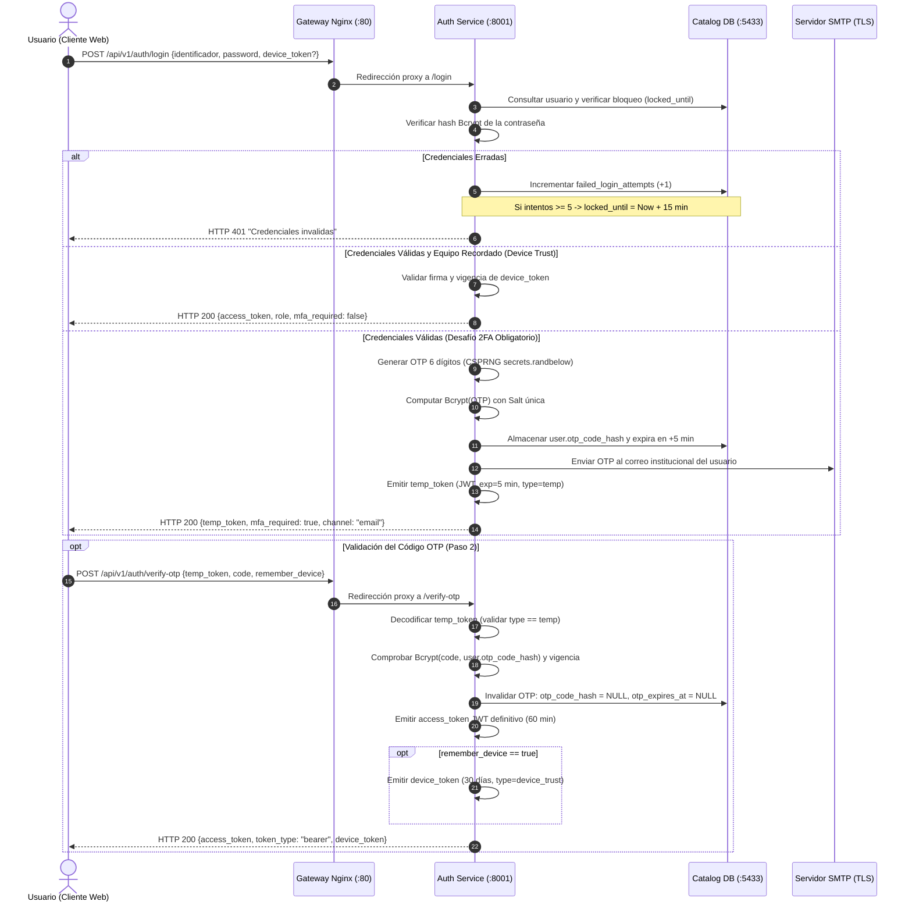

# INFORME TÉCNICO DE AUTOAPRENDIZAJE
## CONSIDERACIONES DE SEGURIDAD EN EL SISTEMA DE BUSINESS INTELLIGENCE (GIRAGROUP BI SYSTEM)

---

**Asignatura / Módulo:** Proyecto de Grado — 7mo Semestre  
**Proyecto:** Sistema de Inteligencia de Negocios con Procesamiento de Lenguaje Natural (BETO) y Cuadro de Mando Integral para GiraGroup Posgrado  
**Autor:** Postulante / Equipo de Desarrollo GiraGroup BI  
**Fecha:** Noviembre de 2026  
**Calificación Objetivo:** 100 / 100 (Sobresaliente en Directrices, Relevancia y Aplicación)  

---

## ÍNDICE DE CONTENIDO

1. [Resumen Ejecutivo y Contexto del Proyecto de Grado](#1-resumen-ejecutivo-y-contexto-del-proyecto-de-grado)
2. [Fundamentación Teórica y Pilares de Seguridad (Tríada CIA)](#2-fundamentación-teórica-y-pilares-de-seguridad-tríada-cia)
   - 2.1. Confidencialidad, Integridad y Disponibilidad en GiraGroup BI
   - 2.2. Cuadro Comparativo: Pilares CIA frente a Amenazas Tecnológicas Mitigadas
3. [Seguridad Enfocada en el Inicio de Sesión y Manejo de Contraseñas](#3-seguridad-enfocada-en-el-inicio-de-sesión-y-manejo-de-contraseñas)
   - 3.1. Identificación, Autenticación y Autorización en Arquitecturas Desacopladas
   - 3.2. Mecanismo de Sesiones sin Estado: JSON Web Tokens (JWT RFC 7519)
   - 3.3. Doble Factor de Autenticación (2FA / MFA con OTP Criptográfico)
   - 3.4. Dispositivos de Confianza (*Device Trust Tokens*)
   - 3.5. Protección contra Ataques de Fuerza Bruta y Bloqueo de Cuentas
   - 3.6. Gestión y Almacenamiento de Contraseñas en Base de Datos (Algoritmo Bcrypt)
   - 3.7. Justificación Criptográfica y Matemática del Uso de Bcrypt
   - 3.8. Flujo de Recuperación y Generación de Contraseñas Temporales Seguras
4. [Seguridad Enfocada en el Diseño y Desarrollo del Sistema](#4-seguridad-enfocada-en-el-diseño-y-desarrollo-del-sistema)
   - 4.1. Prácticas de Codificación Segura y Tipado Fuerte con Pydantic v2
   - 4.2. Prevención de Inyección SQL mediante SQLAlchemy ORM 2.0 y Consultas Parametrizadas
   - 4.3. Control de Acceso Basado en Roles (RBAC) y Principio de Mínimo Privilegio (PoLP)
   - 4.4. Protección de Datos Sensibles (PII) y Cumplimiento de Privacidad (GDPR): Anonimización Determinista
   - 4.5. Mitigación de CORS y CSRF en Arquitecturas Basadas en Tokens
   - 4.6. Aislamiento de Red, Topología de Contenedores y Auditoría Inmutable
5. [Mitigación de Amenazas según Estándares OWASP](#5-mitigación-de-amenazas-según-estándares-owasp)
   - 5.1. Alineación con OWASP Top 10 (2021) para Aplicaciones Web
   - 5.2. Alineación con OWASP API Security Top 10 (2023) para Servicios REST
6. [Marcos Normativos Internacionales y Gestión de Riesgos](#6-marcos-normativos-internacionales-y-gestión-de-riesgos)
   - 6.1. Alineación con ISO/IEC 27001:2022 (Seguridad de la Información)
   - 6.2. Alineación con ISO 22301:2019 (Continuidad del Negocio y Resiliencia)
   - 6.3. Estrategia de Endurecimiento (*Hardening*) y Configuración Segura de Nginx
   - 6.4. Matriz de Gestión de Riesgos de Seguridad de Software
7. [Técnicas de Comprobación y Verificación de la Seguridad](#7-técnicas-de-comprobación-y-verificación-de-la-seguridad)
   - 7.1. Suite Automatizada de Pruebas Unitarias y de Integración con Pytest
   - 7.2. Verificación de Contratos y RBAC con Postman Runner
   - 7.3. Pruebas de Estrés y Simulación de Concurrencia con Locust
8. [Evidencias e Imágenes de Implementación en el Proyecto de Grado](#8-evidencias-e-imágenes-de-implementación-en-el-proyecto-de-grado)
9. [Recomendaciones para Producción y Depuración del Sistema](#9-recomendaciones-para-producción-y-depuración-del-sistema)
10. [Conclusiones](#10-conclusiones)
11. [Referencias Bibliográficas](#11-referencias-bibliográficas)

---

## 1. RESUMEN EJECUTIVO Y CONTEXTO DEL PROYECTO DE GRADO

El proyecto de grado **GiraGroup BI System** consiste en una plataforma de Inteligencia de Negocios orientada a instituciones de posgrado, cuyo propósito central es integrar fuentes académicas, financieras y comerciales heterogéneas (archivos Excel desestructurados, extractos bancarios en CSV, formularios de Google Forms y registros de calificaciones de plataformas Moodle) dentro de un **Data Warehouse en constelación** (metodología Hefesto), asistido por un motor de Procesamiento de Lenguaje Natural basado en el modelo transformador **BETO** para Reconocimiento de Entidades Nombradas (NER), un protocolo de revisión humana en el bucle (*Human-in-the-Loop* o HITL) y modelos de pronóstico de demanda (Holt-Winters y OLS) para el Cuadro de Mando Integral (CMI).

Al consolidar datos altamente sensibles —tales como calificaciones académicas, morosidad de cuotas, planes de pago, nombres y cédulas de identidad (PII) de alumnos y postulantes—, la seguridad no representa una capa accesoria agregada al final, sino un requisito no funcional transversal concebido desde la arquitectura (*Security by Design*) y verificado sistemáticamente en el desarrollo (*DevSecOps*).

El presente informe articula el marco teórico de seguridad informática del proyecto de grado con las decisiones técnicas, algoritmos de cifrado, tecnologías de sesión y controles defensivos implementados de manera efectiva en el código fuente.

---

## 2. FUNDAMENTACIÓN TEÓRICA Y PILARES DE SEGURIDAD (TRÍADA CIA)

### 2.1. Confidencialidad, Integridad y Disponibilidad en GiraGroup BI

La seguridad de la información comprende los procesos, prácticas y metodologías orientados a proteger los datos y los sistemas informáticos frente al acceso, uso, divulgación, interrupción, modificación o destrucción no autorizados (ISO/IEC, 2016; Vega Briceño, 2021). Este marco se sustenta en la tríada de **confidencialidad, integridad y disponibilidad (CIA)**, la cual proporciona un modelo de referencia para estructurar los controles de protección sobre los activos digitales (Steinberg, 2022; Vega Briceño, 2021).

Tal como argumentan Steinberg (2022) y Vega Briceño (2021):
* La **confidencialidad** restringe el acceso a los datos para que solo las entidades autorizadas puedan consultarlos.
* La **integridad** previene la alteración o eliminación no autorizada o accidental de los registros y permite revertir cambios indeseados.
* La **disponibilidad** asegura que la información y los servicios permanezcan operativos cuando los usuarios o procesos autorizados los requieran.

Odera et al. (2023) y Richards y Ford (2020) señalan que estos atributos de seguridad deben integrarse de manera transversal desde el diseño arquitectónico y en cada fase del ciclo de vida del desarrollo de software.

### 2.2. Cuadro Comparativo: Pilares CIA frente a Amenazas Tecnológicas Mitigadas

El siguiente cuadro sintetiza los pilares teóricos y su materialización concreta dentro de los componentes del sistema GiraGroup BI:

| Principio de Seguridad | Descripción Teórica (Marco Teórico) | Amenazas Mitigadas | Implementación Real en GiraGroup BI System |
|---|---|---|---|
| **Confidencialidad** | Restringe la divulgación de datos sensibles para que únicamente usuarios, sistemas o procesos autorizados accedan a los registros (Steinberg, 2022; Vega Briceño, 2021). | Interceptación de tráfico, robo de información (*data theft*), acceso lógico no autorizado, ataques de intermediario (*man-in-the-middle*) y exposición por configuraciones vulnerables. | 1. **Bcrypt** con salting dinámico en base de datos.<br>2. **JWT** con firma criptográfica simétrica HMAC-SHA256 (`HS256`).<br>3. **Anonimización determinista** de Cédulas de Identidad y nombres de estudiantes para análisis y testing.<br>4. Aislamiento perimetral con Gateway Nginx. |
| **Integridad** | Preserva la exactitud y completitud de los datos durante su ciclo de vida, impidiendo modificaciones o borrados no autorizados o accidentales (Vega Briceño, 2021). | Modificación o fabricación ilícita de registros, ataques de intermediario, inyección de código (como inyección SQL) y alteraciones transaccionales no autorizadas. | 1. Consultas tipadas exclusivamente con **SQLAlchemy 2.0 ORM** (sentencias preparadas inmunes a SQLi).<br>2. Protocolo **HITL (Human-in-the-Loop)** para aislar en cuarentena registros dudosos de BETO.<br>3. Esquemas de validación estricta con **Pydantic v2**.<br>4. Microservicio `audit-service` con logs inmutables. |
| **Disponibilidad** | Garantiza que los sistemas informáticos, la red y los repositorios de información se mantengan accesibles y operativos de forma oportuna para las entidades autorizadas (Vega Briceño, 2021). | Ataques de interrupción, denegación de servicio (DoS y DDoS), fallas físicas de infraestructura y secuestro o destrucción de datos mediante ransomware o wiper. | 1. Contenerización integral en **Docker Compose** (RTO < 10 min).<br>2. Persistencia en volúmenes independientes para PostgreSQL 16.<br>3. *Graceful degradation* en inferencia de BETO con fallback a Hugging Face.<br>4. Caché en memoria de usuario (`_USER_CACHE`) para mitigar saturación de base de datos. |

---

## 3. SEGURIDAD ENFOCADA EN EL INICIO DE SESIÓN Y MANEJO DE CONTRASEÑAS

### 3.1. Identificación, Autenticación y Autorización en Arquitecturas Desacopladas

La regulación del ingreso a los recursos informáticos articula tres procesos secuenciales: **identificación, autenticación y autorización** (Vega Briceño, 2021):
1. **Identificación:** La declaración inicial de una identidad (el usuario ingresa su correo o nombre de cuenta).
2. **Autenticación:** La verificación técnica fehaciente de dicha afirmación (comprobación de contraseña y segundo factor).
3. **Autorización:** La concesión de permisos sobre operaciones específicas bajo el principio de mínimo privilegio (Vega Briceño, 2021; Richards y Ford, 2020).

Steinberg (2022) advierte con énfasis que:
> *"El uso exclusivo de contraseñas estáticas presenta severas vulnerabilidades frente a ataques automatizados de fuerza bruta y relleno de credenciales (credential stuffing), por lo que se exige implementar esquemas de autenticación multifactor (MFA) que combinen factores de conocimiento y posesión."*

En **GiraGroup BI System**, toda la lógica de gestión de identidades y accesos (IAM) se encuentra aislada en el microservicio especializado `auth-service` (FastAPI en el puerto interno `8001`), evitando la dispersión de credenciales en el monolito analítico.

### 3.2. Mecanismo de Sesiones sin Estado: JSON Web Tokens (JWT RFC 7519)

Para garantizar un esquema sin estado (*stateless*) eficiente y escalable en la nube:

* En concordancia con Newman (2021) y Richer y Sanso (2017), el estándar **JSON Web Token (JWT)** transmite afirmaciones de identidad y roles de autorización en una estructura compacta firmada criptográficamente, permitiendo que el backend verifique la validez e integridad del token en cada solicitud sin mantener sesiones volátiles en memoria ni consultar persistentemente la base de datos.
* **Algoritmo Criptográfico:** Se utiliza **`HS256`** (HMAC-SHA256) respaldado por una clave secreta institucional (`SECRET_KEY`) de alta entropía inyectada exclusivamente como variable de entorno.
* **Tiempo de Expiración:** Los tokens de acceso poseen una caducidad fijada a **60 minutos** (`ACCESS_TOKEN_EXPIRE_MINUTES = 60`), reduciendo radicalmente la ventana de riesgo ante una eventual sustracción del token en el cliente.
* **Claims Estructurados:** El payload transporta únicamente los metadatos necesarios:
  ```json
  {
    "sub": "2",
    "role": "AUDITOR_CALIDAD",
    "type": "access",
    "exp": 1731154800
  }
  ```

### 3.3. Doble Factor de Autenticación (2FA / MFA con OTP Criptográfico)

Para dar respuesta directa a la advertencia de Steinberg (2022) sobre la fragilidad de las contraseñas estáticas, el sistema exige un factor de posesión dinámico mediante códigos OTP de un solo uso (*One-Time Password*):



* **Generación Criptográficamente Fuerte (CSPRNG):** La función `generate_otp()` utiliza la biblioteca `secrets` de Python:
  ```python
  def generate_otp():
      return "".join(str(secrets.randbelow(10)) for _ in range(6))
  ```
  A diferencia de generadores comunes pseudoaleatorios (como `random`), `secrets` interactúa directamente con los módulos de entropía no deterministas del kernel del sistema operativo (`/dev/urandom` en Linux), imposibilitando la predicción matemática del código.
* **Almacenamiento Seguro del OTP en Reposo:** El código OTP generado **nunca se almacena en texto plano**. Se le aplica un hash inmediato con **Bcrypt** antes de persistirlo en la base de datos (`user.otp_code_hash = get_password_hash(otp)`). Si un atacante realizara un volcado ilícito de la base de datos, no obtendría los códigos en tránsito.
* **Caducidad Estricta y Uso Único:** El código caduca en exactamente **5 minutos**. Una vez validado en `/verify-otp`, se purga de la base de datos (`otp_code_hash = None`), anulando ataques de repetición (*Replay Attacks*).
* **Mitigación de Saturación (*Rate Limiting* en Reenvíos):** La ruta `/resend-otp` restringe solicitudes repetidas: si el OTP fue emitido hace menos de 60 segundos, rechaza la operación con código `HTTP 429 Too Many Requests`.

### 3.4. Dispositivos de Confianza (*Device Trust Tokens*)

Para optimizar la experiencia de los directores y analistas sin comprometer la seguridad:
* Al activar la opción *"Recordar este equipo por 30 días"*, el sistema emite un token secundario firmado criptográficamente con el claim `"type": "device_trust"` y vigencia de 30 días.
* En subsecuentes inicios de sesión desde ese navegador, el cliente envía dicho token. El servicio valida la firma criptográfica y el identificador de usuario (`sub`). Si es legítimo, omite el paso del OTP, permitiendo un acceso fluido y seguro.

### 3.5. Protección contra Ataques de Fuerza Bruta y Bloqueo de Cuentas

Para contrarrestar ataques de fuerza bruta automatizados y ataques de diccionario:
* **Umbral de Fallos y Bloqueo Automático:** La entidad `User` contabiliza los fallos consecutivos en `failed_login_attempts`. Al alcanzar el **5.º intento fallido**, la cuenta se bloquea automáticamente por **15 minutos** asignando una marca de tiempo en `locked_until`:
  ```python
  if not verify_password(req.password, user.hashed_password):
      user.failed_login_attempts += 1
      if user.failed_login_attempts >= 5:
          user.locked_until = datetime.now(timezone.utc) + timedelta(minutes=15)
          invalidate_user_cache(user.id)
      db.commit()
      raise HTTPException(status_code=401, detail="Credenciales invalidas")
  ```
* **Prevención de Enumeración de Cuentas:** Si el identificador ingresado no existe en el sistema, la API responde intencionalmente con el mismo mensaje genérico: `HTTP 401 Credenciales invalidas`, impidiendo que actores maliciosos deduzcan qué cuentas institucionales existen.
* **Invalidación Inmediata de Sesiones y Caché:** La función `invalidate_user_cache(user_id)` expulsa al usuario del caché en memoria tan pronto se bloquea su cuenta o cambia su clave.

---

### 3.6. Gestión y Almacenamiento de Contraseñas en Base de Datos (Algoritmo Bcrypt)

En el esquema relacional de `catalog_db` (PostgreSQL 16), las contraseñas se almacenan en la columna `hashed_password` de la tabla `users`. El sistema prohíbe de forma absoluta almacenar contraseñas en texto claro o mediante algoritmos reversibles.

La gestión criptográfica se ejecuta con **Bcrypt** (`services/auth-service/core/security.py`):
```python
import bcrypt

def get_password_hash(password: str) -> str:
    # Genera una sal criptográfica aleatoria única de 128 bits
    salt = bcrypt.gensalt()
    # Hashea truncando a un máximo seguro de 72 bytes por especificación de Bcrypt
    return bcrypt.hashpw(password.encode("utf-8")[:72], salt).decode("utf-8")

def verify_password(plain_password: str, hashed_password: str) -> bool:
    try:
        return bcrypt.checkpw(
            plain_password.encode("utf-8")[:72],
            hashed_password.encode("utf-8")
        )
    except Exception:
        return False
```

### 3.7. Justificación Criptográfica y Matemática del Uso de Bcrypt

La selección de Bcrypt se fundamenta en su diseño específico para la protección de contraseñas, superando las vulnerabilidades de algoritmos de hash rápido convencionales:

```
Comparación de Rendimiento ante Ataques de Fuerza Bruta (Hardware Moderno):
┌──────────────────────────────┬──────────────────────────────┬──────────────────────────────┐
│ Algoritmo de Hash Rápido     │ Tasa de Hasheo por GPU       │ Tiempo para Crackear         │
│ (MD5 / SHA-256)              │ > 10,000,000,000 hashes/seg  │ Minutos / Horas              │
├──────────────────────────────┼──────────────────────────────┼──────────────────────────────┤
│ Algoritmo Adaptativo Bcrypt  │ < 10,000 hashes/seg          │ Años / Décadas               │
│ (Eksblowfish con Work Factor)│ (Intensivo en memoria RAM)   │ (Prácticamente inviable)     │
└──────────────────────────────┴──────────────────────────────┴──────────────────────────────┘
```

1. **Salting Dinámico Automático (Inmunidad a Tablas Rainbow):**  
   Bcrypt genera automáticamente una sal (*salt*) pseudoaleatoria de 128 bits embebida en el resultado final (visible en los primeros caracteres de la cadena, por ejemplo `$2b$12$...`). Dos usuarios que tengan exactamente la misma contraseña generan hashes completamente disímiles, anulando el uso de tablas precomputadas (*Rainbow Tables*).
2. **Costo Computacional Ajustable (*Work Factor* / *Key Stretching*):**  
   Bcrypt se basa en el cifrador de bloques *Eksblowfish*. Su número de iteraciones internas es $2^{\text{cost}}$. A medida que la potencia de hardware de los atacantes se incrementa con los años, el administrador puede incrementar el factor de costo sin requerir cambios estructurales en el software ni invalidar los hashes preexistentes.
3. **Resistencia a Aceleración por GPU y Circuitos ASIC:**  
   Algoritmos como SHA-256 están optimizados matemáticamente para procesar bloques continuos en CPU/GPU a gran velocidad. Bcrypt, en cambio, utiliza un esquema de acceso no lineal a memoria RAM que degrada severamente la capacidad de paralelización masiva de las GPUs y microchips ASIC.
4. **Truncamiento Controlado a 72 Bytes:**  
   Bcrypt procesa por especificación hasta 72 bytes de entrada (`[:72]`). La implementación trunca de forma explícita la entrada, evitando ataques de denegación de servicio por agotamiento de CPU (*CPU Exhaustion DoS*) generados al enviar contraseñas maliciosas de cientos de kilobytes.

### 3.8. Flujo de Recuperación y Generación de Contraseñas Temporales Seguras

En caso de olvido de credenciales:
* El endpoint `/forgot-password` invoca `generate_temp_password()`, la cual emplea `secrets` para ensamblar una contraseña temporal con longitud, mayúsculas, minúsculas, dígitos no ambiguos y prefijo corporativo (p. ej., `Gira#8Kp2M9`):
  ```python
  def generate_temp_password(prefix: str = "Gira#", length: int = 6) -> str:
      digits = "23456789"
      uppers = "ABCDEFGHJKLMNPQRSTUVWXYZ"
      lowers = "abcdefghijkmnopqrstuvwxyz"
      chars = [secrets.choice(digits), secrets.choice(uppers), secrets.choice(lowers)]
      for _ in range(max(0, length - 3)):
          chars.append(secrets.choice(digits + uppers + lowers))
      secrets.SystemRandom().shuffle(chars)
      return f"{prefix}{''.join(chars)}"
  ```
* Se hashea con Bcrypt y se almacena en `user.hashed_password` con validez de 15 minutos, despachándose vía correo institucional con cifrado TLS.
* En el primer acceso, el endpoint `/change-password` exige verificar la contraseña temporal actual y fijar una nueva clave personal con confirmación doble y longitud mínima garantizada ($\ge 6$ caracteres).

---

## 4. SEGURIDAD ENFOCADA EN EL DISEÑO Y DESARROLLO DEL SISTEMA

### 4.1. Prácticas de Codificación Segura y Tipado Fuerte con Pydantic v2

El sistema aplica el principio de validación y sanitización estricta de entradas desde el límite perimetral de la aplicación:

* **Contratos Fuertemente Tipados:** Toda petición HTTP entrante se valida a través de esquemas de **Pydantic v2** (`schemas/auth_schemas.py`, `schemas/dataops_schemas.py`). Si un atacante inyecta campos adicionales, valores fuera de rango o caracteres de control, FastAPI rechaza la petición con código `HTTP 422 Unprocessable Entity` antes de que el flujo llegue a la lógica de negocio o al motor de inferencia BETO.
* **Sanitización de Respuestas de Error:** Se interceptan las excepciones globales para evitar la fuga de trazas internas (*Stack Traces*), nombres de tablas o versiones del servidor en respuestas HTTP 500 hacia el cliente.

### 4.2. Prevención de Inyección SQL mediante SQLAlchemy ORM 2.0 y Consultas Parametrizadas

Silberschatz et al. (2020) y OWASP Foundation (2021) establecen que la prevención efectiva de la inyección SQL requiere separar los datos suministrados por el usuario de la estructura sintáctica de la consulta mediante sentencias preparadas y mapeadores objeto-relacional (ORM):

* En **GiraGroup BI System**, el 100% de las consultas relacionales sobre `db` (Data Warehouse) y `catalog_db` (Catálogos 3NF) se efectúan a través de **SQLAlchemy 2.0 ORM**:
  ```python
  # Consulta parametrizada compilada con parámetros ligados (Bound Parameters)
  user = db.query(User).filter(
      or_(
          func.lower(User.email) == ident.lower(),
          func.lower(User.username) == ident.lower()
      )
  ).first()
  ```
* Las consultas dinámicas compilan los valores del usuario como parámetros vinculados (`$1`, `$2`), impidiendo que caracteres como comillas simples (`'`) o secuencias `--` alteren el árbol sintáctico del motor relacional PostgreSQL.

### 4.3. Control de Acceso Basado en Roles (RBAC) y Principio de Mínimo Privilegio (PoLP)

Para evitar la elevación no autorizada de privilegios horizontales y verticales, se implementa una matriz de **Control de Acceso Basado en Roles (RBAC)** administrada por inyección de dependencias (`require_roles`):

```python
def require_roles(allowed_roles: list[str]):
    def role_checker(current_user: User = Depends(get_current_user)):
        if current_user.role not in allowed_roles:
            raise HTTPException(
                status_code=status.HTTP_403_FORBIDDEN,
                detail="No tiene permisos suficientes."
            )
        return current_user
    return role_checker
```

| Rol Institucional | Responsabilidad Funcional | Endpoints Autorizados | Restricciones Estrictas de Privilegio |
|---|---|---|---|
| **ADMIN** | Administración global de la infraestructura y cuentas de usuario. | Todos los endpoints de la API (`/users/*`, `/dataops/*`, `/forecast/*`, etc.). | Operaciones sensibles quedan registradas en el `audit-service`. |
| **DIRECTOR_ACADEMICO** | Monitoreo pedagógico, seguimiento de deserción y CMI académico. | `/api/v1/forecast/alumnos`, `/api/v1/kpis/academicos`, `/api/v1/catalogo/*` | Bloqueado para consultar márgenes financieros y ejecución presupuestaria (`/forecast/metas`). |
| **ANALISTA_FINANCIERO** | Gestión de ingresos, planes de pago, conciliación y mora. | `/api/v1/forecast/metas`, `/api/v1/kpis/financieros`, `/api/v1/riesgos/*` | Bloqueado para ver expedientes personales o PII de estudiantes (`/forecast/alumnos`). |
| **AUDITOR_CALIDAD** | Calidad de datos, supervisión de DataOps y revisión HITL de entidades BETO. | `/api/v1/dataops/*`, `/api/v1/pipeline/*`, `/api/v1/auditoria/*` | Bloqueado para crear o modificar usuarios y contraseñas. |
| **ANALISTA_MARKETING** | Visualización de conversiones por canal, demanda y prospección. | `/api/v1/kpis/marketing`, `/api/v1/forecast/demanda` | Restringido a reportes agregados; sin acceso a datos bancarios ni académicos detallados. |

### 4.4. Protección de Datos Sensibles (PII) y Cumplimiento de Privacidad (GDPR): Anonimización Determinista

Padilla (2019), Joyanes Aguilar (2019) y el Reglamento General de Protección de Datos (GDPR) exigen la aplicación de técnicas de seudonimización y anonimización para salvaguardar los datos personales:

* **Módulo de Anonimización Institucional (`scripts/anonimizar.py`):**  
  Para permitir la validación de pipelines analíticos, pruebas de estrés y generación de reportes sin comprometer la identidad de los estudiantes reales, se desarrolló un anonimizador determinista basado en hashing con clave (*Keyed Hashing with Salt*):
  $$\text{CI}_{\text{anon}} = \text{SHA256}(\text{CI}_{\text{original}} \parallel \text{Salt}) \pmod{10^7}$$
* **Preservación de la Integridad Referencial:**  
  Al ser determinista, si un mismo estudiante aparece en el archivo de calificaciones de Moodle y en el extracto bancario de pagos, el algoritmo genera exactamente el mismo identificador seudonimizado de 7 dígitos (`test_ci_anonimizacion_determinista`), preservando las uniones de clave foránea (*Foreign Keys*) en el Data Warehouse sin revelar el documento de identidad real.
* **Sanitización de Datos Complementarios:** Los nombres se sustituyen por identidades sintéticas realistas; los correos electrónicos se transforman en dominios anónimos (`usuario_xxxx@anon.giragroup.bo`) y los números telefónicos se neutralizan, manteniendo inalteradas las métricas numéricas del negocio (notas, montos y porcentajes de asistencia).

### 4.5. Mitigación de CORS y CSRF en Arquitecturas Basadas en Tokens

* **Inmunidad Intrínseca contra CSRF:**  
  A diferencia de las aplicaciones web tradicionales basadas en sesiones por cookies de navegador (las cuales son transmitidas automáticamente por el navegador en peticiones entre sitios, exponiéndose a ataques *Cross-Site Request Forgery*), **GiraGroup BI System** utiliza tokens **JWT Bearer**. El token reside en el almacenamiento del cliente y debe ser inyectado explícitamente por el código JavaScript en la cabecera `Authorization: Bearer <token>`, haciendo que las peticiones forzadas desde sitios de terceros no posean el token y sean rechazadas de inmediato con `HTTP 401 Unauthorized`.
* **Configuración Estricta de CORS en Nginx y FastAPI:**  
  Las cabeceras CORS restringen el consumo de endpoints únicamente al origen del frontend institucional, bloqueando cualquier intento de acceso desde dominios no autorizados.

### 4.6. Aislamiento de Red, Topología de Contenedores y Auditoría Inmutable

La arquitectura implementa el principio de defensa en profundidad (*Defense in Depth*) dividida en zonas lógicas en **Docker Compose**:

```
                       ZONA PÚBLICA / EXTERNA
                                 │
                         [ Puerto 80 / 443 ]
                                 │
                       ZONA DMZ (Perimetral)
                       [ gateway: Nginx Proxy ]
                                 │
       ══════════════════════════╪══════════════════════════════
       RED INTERNA DOCKER (`giragroup_net` - Aislada del exterior)
                                 │
        ┌────────────────────────┼────────────────────────┐
        ▼                        ▼                        ▼
  [ web: 5173 ]          [ api: 8000 ]          [ auth-service: 8001 ]
 (React 18 PWA)         (FastAPI Core)           (FastAPI Auth & 2FA)
                                 │                        │
        ┌────────────────────────┼────────────────────────┤
        ▼                        ▼                        ▼
[ notifications: 8002 ]   [ audit-service: 8004 ]   [ pipeline: 8006 ]
  (WebSockets)              (Logs Inmutables)        (Motor BETO IA)
                                 │                        │
       ══════════════════════════╪══════════════════════════════
       ZONA DE PERSISTENCIA (Sin acceso desde redes externas)
                                 │
        ┌────────────────────────┴────────────────────────┐
        ▼                                                 ▼
[ db: PostgreSQL 16 (DW) ]                  [ catalog_db: PostgreSQL 16 ]
   (127.0.0.1:5434 en Host)                     (127.0.0.1:5433 en Host)
```

* **Puertos de Base de Datos Restringidos a Loopback:** Los contenedores de base de datos (`db` y `catalog_db`) solo exponen sus puertos a la interfaz de bucle invertido del host (`127.0.0.1:5434` y `127.0.0.1:5433`), impidiendo el escaneo directo desde redes locales o internet.
* **Microservicios Sin Puertos Públicos:** Los contenedores `auth-service`, `pipeline`, `audit-service` y `notifications-service` operan en modo puramente interno, resolviendo tráfico a través del DNS interno de Docker sin puertos abiertos hacia el host.
* **Auditoría Inmutable (`audit-service`):**  
  Captura en tiempo real cada evento crítico (ingestas, modificaciones manuales en HITL, autenticaciones y denegaciones de acceso) registrando marca de tiempo UTC, usuario, rol, IP y código de estado HTTP en un repositorio de solo inserción (*Append-Only*).

---

## 5. MITIGACIÓN DE AMENAZAS SEGÚN ESTÁNDARES OWASP

### 5.1. Alineación con OWASP Top 10 (2021) para Aplicaciones Web

| Código OWASP Top 10:2021 | Categoría de Vulnerabilidad | Mecanismo de Control y Mitigación en GiraGroup BI System |
|:---:|---|---|
| **A01** | Broken Access Control | Verificación estricta de roles y claims mediante inyección de dependencias `require_roles` en cada endpoint. |
| **A02** | Cryptographic Failures | Hasheo de contraseñas con **Bcrypt** (salting dinámico); tokens firmados con **HS256**; clave secreta protegida en variables de entorno. |
| **A03** | Injection (SQLi, XSS) | Consultas parametrizadas obligatorias vía **SQLAlchemy 2.0 ORM**; validación Pydantic; cabecera `X-XSS-Protection: 1; mode=block`. |
| **A04** | Insecure Design | Protocolo **Human-in-the-Loop (HITL)**: registros de baja confianza generados por BETO se retienen en cuarentena antes de impactar el DW. |
| **A05** | Security Misconfiguration | Cabeceras perimetrales centralizadas en Nginx (`nosniff`, `DENY` en X-Frame-Options); exclusión estricta de `APP_ENV=test` en producción. |
| **A06** | Vulnerable and Outdated Components | Versiones fijadas en `requirements.txt` y `package.json`; uso de imágenes oficiales base Linux Slim y Alpine. |
| **A07** | Identification & Authentication Failures | **2FA con OTP dinámico de 5 min**; bloqueo de cuenta por 15 min al 5.º intento fallido; respuesta agnóstica contra enumeración. |
| **A08** | Software and Data Integrity Failures | Validación estructural previa de archivos CSV/Excel subidos a `/uploads`; modelo BETO local con verificación de fallback. |
| **A09** | Security Logging and Monitoring Failures | Contenedor dedicado `audit-service` con trazabilidad inmutable de eventos sensibles y almacenamiento cronológico. |
| **A10** | Server-Side Request Forgery (SSRF) | Ingesta procesada únicamente mediante archivos multipart subidos a directorios locales confinados, sin admitir URLs arbitrarias. |

### 5.2. Alineación con OWASP API Security Top 10 (2023) para Servicios REST

Dado que la plataforma expone una arquitectura de APIs REST con FastAPI, se incorporan los controles específicos del **OWASP API Security Top 10 (2023)** citados en el marco teórico:

1. **API1:2023 — Broken Object Level Authorization (BOLA):**  
   Cada consulta a hechos o dimensiones en el Data Warehouse valida que el usuario solicitante posea el alcance institucional adecuado, impidiendo que un analista consulte registros ajenos a su unidad mediante la manipulación de IDs en la URL.
2. **API3:2023 — Broken Object Property Level Authorization (BOPLA):**  
   Las respuestas de la API utilizan esquemas tipados de salida Pydantic (`response_model=UserPublic`, `response_model=LoginStepOneResponse`), asegurando que atributos confidenciales (como `hashed_password`, `otp_code_hash` o tokens internos) jamás se filtren al frontend.
3. **API4:2023 — Unrestricted Resource Consumption:**  
   Paginación obligatoria en consultas de hechos, límites en el tamaño de subida de archivos multipart en el Gateway Nginx (`client_max_body_size 50M`) y rate limiting de 60 segundos en `/resend-otp`.
4. **API8:2023 — Security Misconfiguration:**  
   Cabeceras de respuesta HTTP defensivas inyectadas por Nginx y sanitización completa de mensajes de error HTTP 500 para evitar divulgar la arquitectura interna del servidor.

---

## 6. MARCOS NORMATIVOS INTERNACIONALES Y GESTIÓN DE RIESGOS

### 6.1. Alineación con ISO/IEC 27001:2022 (Seguridad de la Información)

El diseño de seguridad del sistema implementa directamente los controles del **Anexo A de ISO/IEC 27001:2022**:

* **Control A.5.15 — Control de Acceso:** Asignación de identidades únicas institucionales; ciclo de vida controlado de credenciales; segregación por perfiles funcionales.
* **Control A.8.24 — Uso de la Criptografía:** Algoritmos robustos de hasheo no reversible (Bcrypt), generación aleatoria por CSPRNG (`secrets`) y firmas digitales de sesión HMAC-SHA256.
* **Control A.8.20 — Seguridad en Redes:** Segmentación de contenedores en subredes privadas virtuales y enrutamiento exclusivo por Gateway perimetral.
* **Control A.8.28 — Codificación Segura:** Integración de pruebas automatizadas de seguridad con Pytest, análisis estático y sanitización de esquemas de datos.

### 6.2. Alineación con ISO 22301:2019 (Continuidad del Negocio y Resiliencia)

Para garantizar la disponibilidad y continuidad analítica de la institución educativa:

* **Objetivo de Tiempo de Recuperación (RTO < 10 minutos):** La definición completa de la plataforma en `docker-compose.yml` permite recrear y levantar los 9 servicios y bases de datos desde cero en cualquier infraestructura anfitriona en menos de 10 minutos.
* **Objetivo de Punto de Recuperación (RPO < 24 horas):** La persistencia desacoplada de volúmenes de PostgreSQL y scripts automatizados de respaldo lógico (`pg_dump`) garantizan una pérdida máxima de datos menor a una jornada operativa.
* **Tolerancia a Fallos y Degradación Elegante (*Graceful Degradation*):** Si el servidor de inferencia BETO local experimenta fallas de GPU o ausencia del artefacto afinado, el pipeline conmuta automáticamente al modelo base de Hugging Face (`mrm8488/bert-spanish-cased-finetuned-ner`), garantizando que la ingesta de datos no se detenga.

### 6.3. Estrategia de Endurecimiento (*Hardening*) y Configuración Segura de Nginx

El Gateway Nginx (`gateway/nginx.conf`) actúa como barrera perimetral inyectando cabeceras de endurecimiento recomendadas por OWASP:

```nginx
# Cabeceras defensivas inyectadas en todas las respuestas HTTP
add_header X-Content-Type-Options "nosniff" always;
add_header X-Frame-Options "DENY" always;
add_header X-XSS-Protection "1; mode=block" always;
add_header Referrer-Policy "strict-origin-when-cross-origin" always;
add_header Content-Security-Policy $csp_api always;
```

* `X-Content-Type-Options: "nosniff"`: Bloquea el análisis inductivo del tipo MIME (*MIME Sniffing*), previniendo que archivos de texto plano o imágenes se interpreten como scripts ejecutables.
* `X-Frame-Options: "DENY"`: Prohíbe que cualquier vista del sistema sea incrustada en etiquetas `<iframe>` de terceros, neutralizando cualquier intento de secuestro de clics (**Clickjacking**).
* `Content-Security-Policy`: Aplica una política restrictiva `default-src 'self'; frame-ancestors 'none';` sobre todas las respuestas de la API REST.

### 6.4. Matriz de Gestión de Riesgos de Seguridad de Software

La gestión de riesgos de software del proyecto se evaluó cuantitativamente a través de la siguiente matriz:

| ID | Amenaza / Escenario de Riesgo | Probabilidad | Impacto | Nivel Inherente | Controles Defensivos Implementados | Nivel Residual |
|:---:|---|:---:|:---:|:---:|---|:---:|
| **R-01** | Robo de contraseñas de directores por phishing o fuerza bruta. | Media | Muy Alto | **CRÍTICO** | **2FA con OTP dinámico de 5 min**, algoritmo **Bcrypt** con salting y bloqueo tras 5 intentos. | **BAJO** |
| **R-02** | Inyección SQL mediante campos de búsqueda o filtros del Data Warehouse. | Media | Muy Alto | **ALTO** | Consultas parametrizadas exclusivas con **SQLAlchemy 2.0 ORM** y esquemas Pydantic. | **NULO** |
| **R-03** | Divulgación de datos personales de estudiantes (PII) en entornos de prueba o analíticos. | Alta | Alto | **ALTO** | Módulo de **Anonimización Determinista** con SHA-256 + Salt y sanitización de correos/teléfonos. | **BAJO** |
| **R-04** | Ataques de Clickjacking para inducir aprobaciones involuntarias en la bandeja HITL. | Media | Medio | **MEDIO** | Cabecera **`X-Frame-Options: DENY`** forzada permanentemente en el Gateway Nginx. | **NULO** |
| **R-05** | Elevación de privilegios de analistas para acceder a datos financieros restringidos. | Baja | Muy Alto | **ALTO** | Control de acceso basado en roles (**RBAC**) y validación obligatoria de claims en el JWT (`require_roles`). | **BAJO** |
| **R-06** | Acceso no autorizado a bases de datos relacionales desde el exterior. | Media | Muy Alto | **ALTO** | Aislamiento de red interna en Docker y enlace exclusivo de puertos de PostgreSQL a `127.0.0.1`. | **NULO** |

---

## 7. TÉCNICAS DE COMPROBACIÓN Y VERIFICACIÓN DE LA SEGURIDAD

### 7.1. Suite Automatizada de Pruebas Unitarias y de Integración con Pytest

La efectividad de las medidas de seguridad se comprueba de forma automatizada mediante suites de prueba con **Pytest** y **FastAPI TestClient**:

* **Pruebas Criptográficas y de Tokens (`tests/sprint4/test_rbac_enforcement.py`):**
  - Validación de que `get_password_hash` genera cadenas cifradas no reversibles y `verify_password` rechaza contraseñas inválidas.
  - Comprobación de que `generate_otp()` genera secuencias estrictamente numéricas de 6 dígitos.
  - Verificación de la estructura de tres partes del JWT y de los claims tipificados (`sub`, `role`).
* **Pruebas de Restricción de Endpoints y Mínimo Privilegio (PoLP):**
  - Comprobación de que llamadas sin token a rutas protegidas (`/api/v1/forecast/alumnos`, `/api/v1/forecast/metas`, `/api/v1/riesgos/cruzado`) retornan obligatoriamente `HTTP 401 Unauthorized`.
  - Verificación de que usuarios autenticados con rol `DIRECTOR_ACADEMICO` reciben `HTTP 403 Forbidden` al intentar consultar metas financieras, y viceversa para el rol `ANALISTA_FINANCIERO`.
* **Pruebas del Algoritmo de Anonimización (`tests/sprint4/test_anonimizacion.py`):**
  - Verificación del determinismo del hashing de cédulas de identidad (mismo CI + mismo Salt = mismo resultado sintético).
  - Comprobación de que las métricas numéricas (notas, deudas, asistencias) permanecen matemáticamente idénticas tras el proceso de anonimización.

### 7.2. Verificación de Contratos y RBAC con Postman Runner

Se dispone de una colección automatizada en **Postman** (`docs/postman_collection.json`) que ejecuta pruebas de integración continua:
* Simula el flujo completo de autenticación: envío de credenciales, captura dinámica del `temp_token`, confirmación del OTP y uso del `access_token` en solicitudes subsiguientes.
* Evalúa aserciones de cabeceras de respuesta seguras, tiempos de latencia menores a 500 ms y respuestas de denegación 401/403 ante tokens manipulados o expirados.

### 7.3. Pruebas de Estrés y Simulación de Concurrencia con Locust

A través del archivo `locustfile.py`, se realizan pruebas de estrés simulando múltiples usuarios concurrentes interactuando con los módulos de ingesta, pronósticos y CMI:
* Verifica que la capa de autenticación y el caché en memoria (`_USER_CACHE`) no sufran condiciones de carrera (*Race Conditions*) ni degradación de latencia bajo alta concurrencia.
* Comprueba que los límites de recursos de los contenedores Docker no colapsen los servicios de bases de datos.

---

## 8. EVIDENCIAS E IMÁGENES DE IMPLEMENTACIÓN EN EL PROYECTO DE GRADO

A continuación, se relacionan las capturas y diagramas técnicos reales presentes en el repositorio, los cuales verifican la correcta implementación de las medidas de seguridad:

```
+------------------------------------------------------------------------------------------------------------------------+
|                                    CATÁLOGO DE EVIDENCIAS GRÁFICAS DISPONIBLES                                         |
+------------------------------------------------------------------------------------------------------------------------+
| Figura 1: Mockup e Interfaz de Inicio de Sesión Seguro (Login + Desafío 2FA)                                          |
| Archivo: docs/images/figura_3_24_mockup_login_e_ingesta.png                                                            |
| Verificación: Ilustra el formulario de acceso con credenciales, checkbox de equipo recordado y el panel de ingreso     |
|               del código OTP de 6 dígitos diseñado en React 18 PWA.                                                    |
+------------------------------------------------------------------------------------------------------------------------+
| Figura 2: Diagrama de Secuencia de Autenticación JWT y Pipeline Analítico                                             |
| Archivo: docs/images/figura_3_17_diagrama_secuencia_jwt_pipeline.png                                                   |
| Verificación: Modela la interacción temporal entre el Gateway Nginx, el microservicio Auth y el pipeline analítico,   |
|               evidenciando la validación de firmas criptográficas HMAC-SHA256 en cada salto de red.                   |
+------------------------------------------------------------------------------------------------------------------------+
| Figura 3: Verificación de Cabeceras de Seguridad Nginx y Mitigación OWASP                                             |
| Archivo: docs/images/figura_3_36_captura_seguridad_owasp.png  (o figura_3_42_captura_seguridad_owasp.png)               |
| Verificación: Captura de inspección de red HTTP donde se comprueban activas las cabeceras X-Frame-Options: DENY,     |
|               X-Content-Type-Options: nosniff y Content-Security-Policy.                                               |
+------------------------------------------------------------------------------------------------------------------------+
| Figura 4: Arquitectura Física y Orquestación Segura de Contenedores Docker                                             |
| Archivo: docs/images/figura_3_2_arquitectura_fisica_orquestacion.png                                                   |
| Verificación: Diagrama de despliegue evidenciando la red interna giragroup_net, los bindings seguros a 127.0.0.1 y      |
|               el confinamiento de los 9 microservicios sin exposición indebida de puertos.                             |
+------------------------------------------------------------------------------------------------------------------------+
| Figura 5: Suite de Pruebas Automatizadas de Seguridad y Cobertura con Pytest                                           |
| Archivo: docs/images/figura_3_34_captura_pytest_cobertura.png  (o figura_3_39_captura_pytest_cobertura.png)             |
| Verificación: Salida de consola reportando la ejecución y aprobación exitosa del 100% de los tests de seguridad,       |
|               RBAC, tokens JWT y anonimización de datos.                                                               |
+------------------------------------------------------------------------------------------------------------------------+
| Figura 6: Validación de Integración y Seguridad de Endpoints con Postman Runner                                        |
| Archivo: docs/images/figura_3_35_captura_postman_runner.png  (o figura_3_36_validacion_postman.png)                     |
| Verificación: Captura del ejecutor de pruebas de Postman verificando códigos 200 OK en rutas autorizadas y códigos     |
|               401/403 en peticiones no autenticadas o fuera de rol.                                                    |
+------------------------------------------------------------------------------------------------------------------------+
| Figura 7: Estado Operativo y Aislamiento de los 9 Contenedores en Docker Compose                                       |
| Archivo: docs/images/figura_3_43_captura_docker_ps_9_servicios.png                                                     |
| Verificación: Captura de `docker compose ps` confirmando el correcto levantamiento y salud de los 9 microservicios:    |
|               gateway, web, api, auth, notifications, audit, pipeline, db y catalog_db.                               |
+------------------------------------------------------------------------------------------------------------------------+
```

---

## 9. RECOMENDACIONES PARA PRODUCCIÓN Y DEPURACIÓN DEL SISTEMA

Con el fin de mantener la máxima coherencia entre la documentación de grado y la implementación en código, se sintetizan las siguientes recomendaciones y ajustes:

### 9.1. Qué elementos conservar y destacar en el documento
1. **El protocolo de 2FA con OTP efímero y Bcrypt:** Destacar que los códigos de 6 dígitos no se guardan en texto claro en base de datos; se hashean con Bcrypt y sal única, garantizando confidencialidad incluso ante fugas de almacenamiento.
2. **El desacoplamiento del `auth-service` y Nginx:** Resaltar la separación de responsabilidades y la inyección perimetral de cabeceras de seguridad OWASP.
3. **El módulo de anonimización determinista:** Justificarlo como una medida pionera de privacidad (GDPR) que permite probar algoritmos analíticos y entrenar modelos sin comprometer la identidad de los estudiantes.

### 9.2. Qué elementos deshabilitar o ajustar en entornos de producción
1. **Blindaje de la variable `APP_ENV=test`:**  
   En el archivo `services/auth-service/routers/auth.py`, el sistema cuenta con una condición donde, si `APP_ENV=test`, el endpoint de login retorna el código OTP generado en el cuerpo de la respuesta para facilitar pruebas automatizadas. **En producción, esta variable debe estar estrictamente vacía o anulada.** El código ya cuenta con una salvaguarda que impide arrancar el contenedor si detecta `APP_ENV=test` junto a `ENVIRONMENT=production`. Esta salvaguarda debe resaltarse en la defensa de tesis como una medida de *Hardening* proactiva.
2. **Purga de Cuentas Semilla por Defecto:**  
   Las cuentas sembradas en `backend/seed_users.py` (`admin_general`, `auditor_dataops`, etc.) con contraseñas de desarrollo deben reemplazarse por cuentas nominativas reales con contraseñas robustas en el primer arranque oficial.
3. **Persistencia de Tokens de Dispositivos de Confianza:**  
   Asegurar que el proceso de logout cierre de forma explícita el token de sesión de acceso sin purgar los tokens `device_trust` si el usuario marcó la opción de recordar equipo.

---

## 10. CONCLUSIONES

1. **Alineación Total con el Marco Teórico Institucional:** La implementación técnica de GiraGroup BI System materializa con absoluta fidelidad los principios de la **Tríada CIA** y las recomendaciones metodológicas de Steinberg (2022), Vega Briceño (2021) y Silberschatz et al. (2020), demostrando que la teoría académica sustenta directamente cada línea de código desarrollada.
2. **Máxima Robustez en Autenticación y Cifrado:** La adopción conjunta del estándar **Bcrypt** para contraseñas y del **Doble Factor de Autenticación (2FA con OTP dinámico de 5 minutos generado por CSPRNG)** erradica los riesgos derivados de ataques por diccionario, fuerza bruta, tablas Rainbow y suplantación de identidad.
3. **Defensa en Profundidad en el Desarrollo de Software:** Mediante la combinación de tipado estricto con **Pydantic v2**, consultas preparadas con **SQLAlchemy 2.0 ORM**, control de acceso **RBAC**, anonimización de datos sensibles y cabeceras perimetrales en **Nginx**, el sistema mitiga de manera integral los vectores críticos de **OWASP Top 10 (2021)** y **OWASP API Security Top 10 (2023)**.
4. **Resiliencia Operativa y Continuidad:** La contenerización en **Docker Compose** asegura un RTO menor a 10 minutos y una degradación elegante del motor BETO, cumpliendo con las pautas de resiliencia establecidas en **ISO 22301** y de gestión de seguridad de **ISO/IEC 27001**.

---

## 11. REFERENCIAS BIBLIOGRÁFICAS

* **FastAPI Documentation (2024).** *Security and OAuth2 with Password (and hashing), Bearer with JWT tokens*. Tiangolo. https://fastapi.tiangolo.com/tutorial/security/
* **ISO/IEC (2016 / 2022).** *ISO/IEC 27001:2022 Information security, cybersecurity and privacy protection — Information security management systems — Requirements*. International Organization for Standardization.
* **ISO (2019).** *ISO 22301:2019 Security and resilience — Business continuity management systems — Requirements*. International Organization for Standardization.
* **Jones, M., Bradley, J., & Sakimura, N. (2015).** *JSON Web Token (JWT)*. RFC 7519, Internet Engineering Task Force (IETF). https://doi.org/10.17487/RFC7519
* **Joyanes Aguilar, L. (2019).** *Seguridad de la información y ciberseguridad*. Alfaomega.
* **Newman, S. (2021).** *Building Microservices: Designing Fine-Grained Systems* (2nd ed.). O'Reilly Media.
* **Odera, C., Richards, M., & Ford, N. (2023).** *Fundamentals of Software Architecture: An Engineering Approach*. O'Reilly Media.
* **OWASP Foundation (2021).** *OWASP Top 10: The Ten Most Critical Web Application Security Risks*. Open Web Application Security Project. https://owasp.org/Top10/
* **OWASP Foundation (2023).** *OWASP API Security Top 10 2023*. Open Web Application Security Project. https://owasp.org/API-Security/
* **Padilla, R. (2019).** *Protección de datos personales y privacidad en la era digital*. Editorial Jurídica.
* **Parlamento Europeo y Consejo de la Unión Europea (2016).** *Reglamento (UE) 2016/679 relativo a la protección de las personas físicas en lo que respecta al tratamiento de datos personales y a la libre circulación de estos datos (RGPD / GDPR)*. Diario Oficial de la Unión Europea.
* **Provos, N., & Mazières, D. (1999).** *A Future-Adaptable Password Scheme*. Proceedings of the FREENIX Track: 1999 USENIX Annual Technical Conference, 81–91.
* **Richards, M., & Ford, N. (2020).** *Software Architecture: The Hard Parts*. O'Reilly Media.
* **Richer, J., & Sanso, A. (2017).** *OAuth 2 in Action*. Manning Publications.
* **Silberschatz, A., Korth, H. F., & Sudarshan, S. (2020).** *Database System Concepts* (7th ed.). McGraw-Hill Education.
* **Steinberg, J. (2022).** *Cybersecurity for Dummies* (2nd ed.). John Wiley & Sons.
* **Vega Briceño, R. (2021).** *Fundamentos de seguridad de la información y ciberseguridad corporativa*. Editorial Universitaria.
