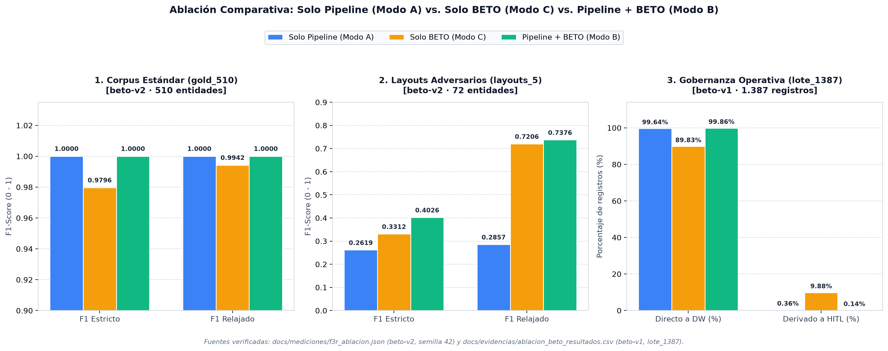
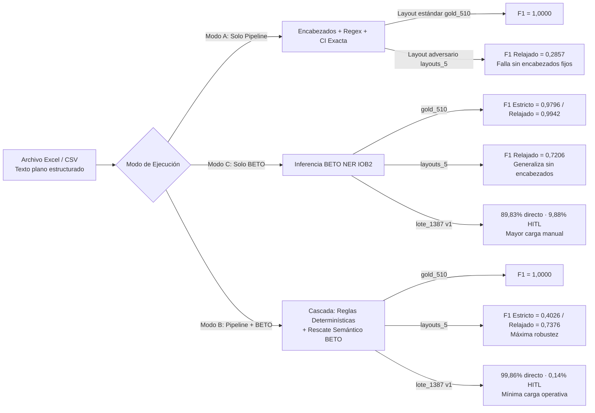

# Comparativa de Ablación: Solo Pipeline (Modo A) vs. Solo BETO (Modo C) vs. Pipeline + BETO (Modo B)

> **Alcance:** Análisis comparativo técnico (documental, fuera de la interfaz web) que evalúa el aporte incremental del modelo **BETO** sobre el pipeline determinístico de reglas, y viceversa.

---

## 1. Gráfico Comparativo Generado

*Archivo generado:* `docs/cronograma/comparativa_ablacion_beto_pipeline.png` (complementario al gráfico oficial de tesis `docs/evidencias/graficos_v2/grafico_3_3_ablacion_modelos_ner.png`).

---

## 2. Tabla Comparativa Consolidada

| Dimensión / Dataset | Criterio / Métrica | Solo Pipeline (Modo A) | Solo BETO (Modo C) | Pipeline + BETO (Modo B · Híbrido) | Fuente Verificada |
|---|---|---:|---:|---:|---|
| **`gold_510`** (`beto-v2`, 510 ent.) | **F1 Estricto** (`seqeval`) | `1,0000` | `0,9796` | **`1,0000`** | `docs/mediciones/f3r_ablacion.json` |
| **`gold_510`** (`beto-v2`, 510 ent.) | **F1 Relajado** (solapamiento) | `1,0000` | `0,9942` | **`1,0000`** | `docs/mediciones/f3r_ablacion.json` |
| **`layouts_5`** (adversarios, 72 ent.) | **F1 Estricto** (`seqeval`) | `0,2619` | `0,3312` | **`0,4026`** | `docs/mediciones/f3r_ablacion.json` |
| **`layouts_5`** (adversarios, 72 ent.) | **F1 Relajado** (solapamiento) | `0,2857` | `0,7206` | **`0,7376`** | `docs/mediciones/f3r_ablacion.json` |
| **`lote_1387`** (`beto-v1`, 1.387 reg.) | **Consolidación directa DW** | `99,64%` | `89,83%` | **`99,86%`** | `docs/evidencias/ablacion_beto_resultados.csv` |
| **`lote_1387`** (`beto-v1`, 1.387 reg.) | **Derivación a HITL** | `0,36%` | `9,88%` | **`0,14%`** | `docs/evidencias/ablacion_beto_resultados.csv` |

---

## 3. Flujo de Decisión Comparado (Mermaid)

---

## 4. Conclusión Técnica: Por Qué la Arquitectura Híbrida (Pipeline + BETO) Es Superior

1. **Solo Pipeline (Modo A) es frágil ante cambios estructurales:**
   - Cuando los libros Excel respetan la estructura esperada (`gold_510`), las reglas por encabezado y expresiones regulares alcanzan `1,0000`.
   - Sin embargo, ante **layouts adversarios (`layouts_5`)** donde cambian nombres de columnas o el formato tabular se degrada, el Modo A colapsa a **F1 estricto `0,2619`** y **F1 relajado `0,2857`** (Recall de apenas `15,28%` estricto).
2. **Solo BETO (Modo C) generaliza bien, pero penaliza la operación y la precisión de frontera:**
   - En `layouts_5`, BETO rescata la extracción elevando el **F1 relajado a `0,7206`** (`+0,4349` respecto a Solo Pipeline).
   - No obstante, prescindir de reglas determinísticas (como `CI_EXACTA` y `ENCABEZADO`) introduce errores menores de frontera en `gold_510` (`F1 estricto 0,9796`) y eleva la derivación a revisión humana (**HITL `9,88%`** vs. `0,14%` en el híbrido sobre `lote_1387`).
3. **Pipeline + BETO (Modo B) combina lo mejor de ambos mundos:**
   - Mantiene **`1,0000`** en `gold_510` aprovechando la exactitud determinística cuando la estructura es conocida.
   - Logra el **mejor desempeño absoluto en layouts adversarios (`layouts_5`)**: **F1 estricto `0,4026`** y **F1 relajado `0,7376`**, superando tanto a Solo Pipeline como a Solo BETO.
   - Maximiza la automatización operativa (**`99,86%` directo al DW** y apenas **`0,14%` a HITL** en `lote_1387`), reduciendo al mínimo el esfuerzo de auditoría humana sin sacrificar trazabilidad.
